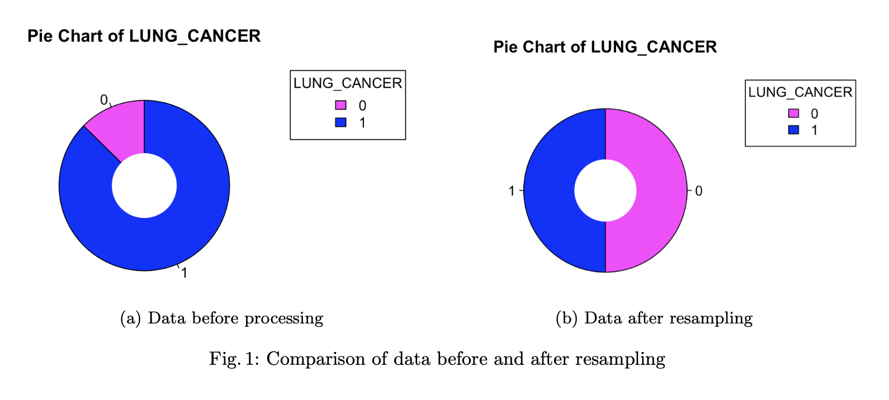
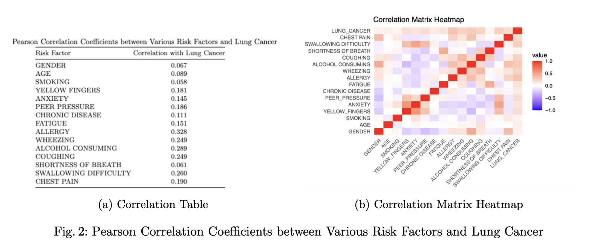
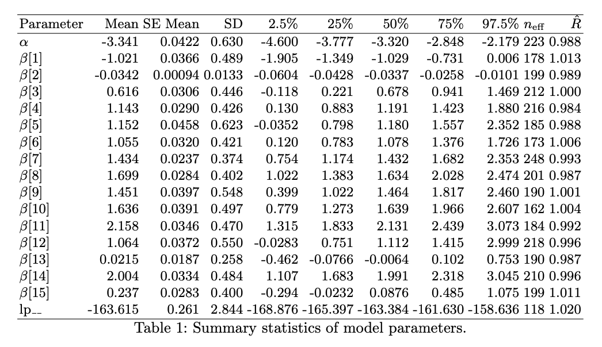
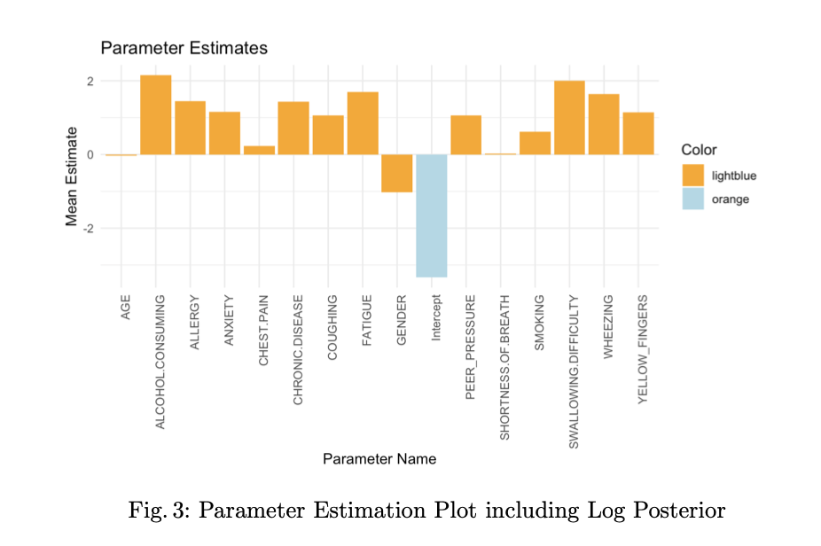
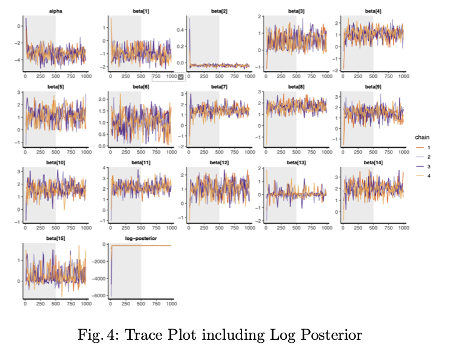
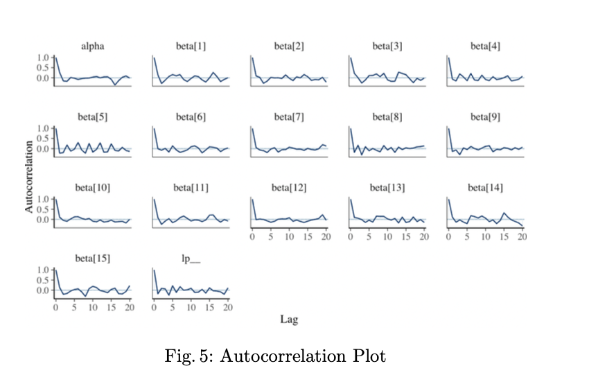
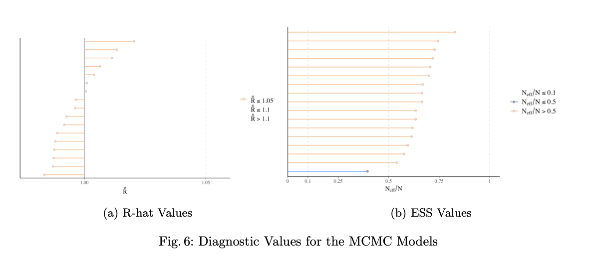
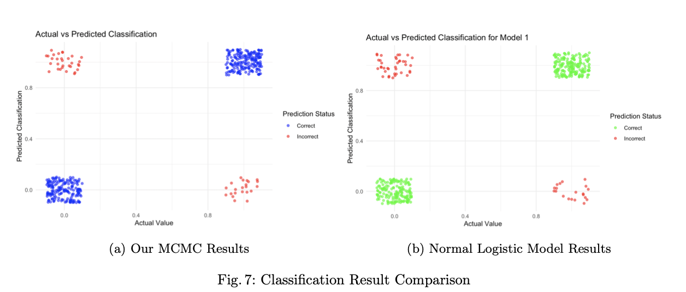
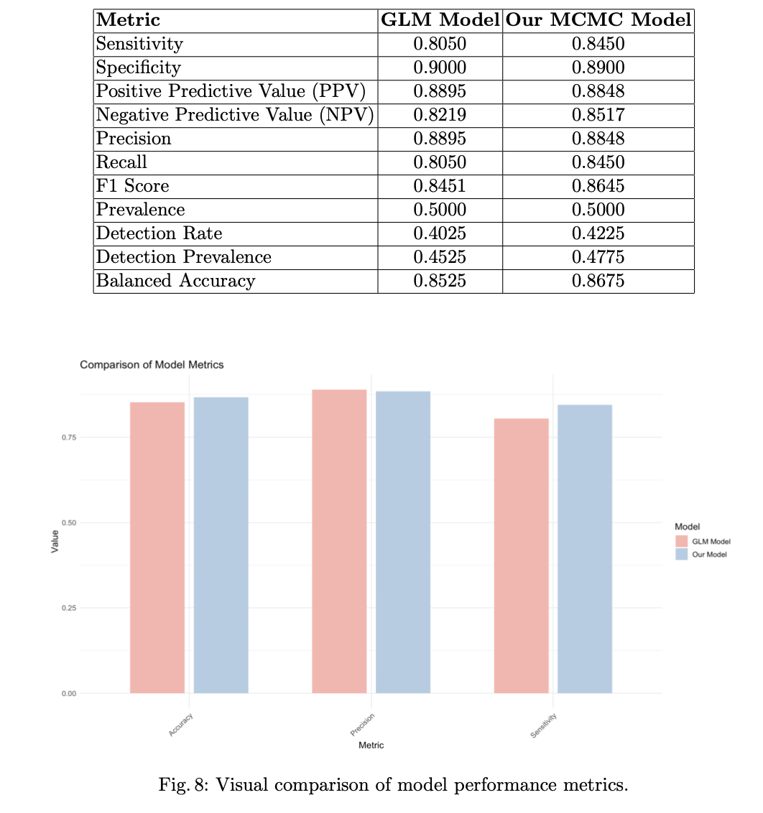

# Bayesian Lung Cancer Prediction

## Overview

This project aims to predict lung cancer using Bayesian logistic regression with Markov Chain Monte Carlo (MCMC) methods. We analyze a dataset of 309 observations and 16 covariates, including risk factors like smoking, yellow fingers, and anxiety. Given the small sample size, Bayesian methods are employed to improve prediction accuracy and provide a robust alternative to traditional logistic regression.

## Methodology

- **Bayesian Framework**: Incorporates prior knowledge and provides a distribution of coefficient estimates rather than single-point estimates.
- **MCMC Techniques**: Utilizes the No-U-Turn sampler in RStan to approximate the posterior distribution of logistic regression coefficients.
- **Model Comparison**: Evaluates the performance of Bayesian logistic regression against standard logistic regression and generalized linear regression with Lasso.

## Tools and Libraries

- **R**: For data analysis and model implementation.
- **RStan**: For MCMC sampling and Bayesian inference.

## Class Imbalance in Lung Cancer Data

Class imbalance is a common issue in medical datasets, such as those used for cancer diagnosis. This imbalance can lead to models that are biased towards the majority class, potentially compromising performance on less frequent classes. To address this, resampling techniques can be applied, such as oversampling the minority class or undersampling the majority class.

In this project, we employed oversampling to balance the dataset by adjusting both classes to have 200 instances each. This method ensures equal representation in the data and helps reduce training bias.

### Visual Representation

- **Figure 1:** Comparison of data before and after resampling.  
  - **(a)** Data before processing
  - **(b)** Data after resampling

### Correlation Analysis

Our correlation analysis revealed key associations with lung cancer:

- **Strong Correlations:** Allergies (0.328), alcohol consumption (0.289), swallowing difficulty (0.260), and wheezing (0.249) were strongly correlated with lung cancer, suggesting these factors are significant indicators.
- **Moderate Correlations:** Yellow fingers, peer pressure, and chest pain displayed moderate correlations.
- **Weak Correlations:** Traditional risk factors such as smoking and age showed weaker associations, indicating a potential need to consider additional factors in lung cancer risk assessments.

While conventional risk factors like smoking exhibit weaker correlations, symptoms such as allergies and behaviors like alcohol consumption show stronger associations. This highlights the importance of considering a broad range of factors in lung cancer risk assessment and suggests areas for future research.

## Model Specification

### Model Construction

Our model predicts the probability of lung cancer given various risk factors, defined as:

$$
P\left(Y_i=1 \mid X_i, \beta, \beta_0\right) = \frac{1}{1 + \exp \left(-\left(\beta_0 + X_i^T \beta\right)\right)}
$$

### Spike-and-Slab Prior

For effective variable selection, we employ a Spike-and-Slab prior:

$$
\beta_i \sim \pi \cdot \mathcal{N}\left(0, \sigma_{\text{slab}}^2\right) + (1-\pi) \cdot \mathcal{N}\left(0, \sigma_{\text{spike}}^2\right)
$$

Where:
- **$\pi$**: Probability that a coefficient comes from the slab distribution (broader Gaussian).
- **$\sigma_{\text{slab}}^2$**: Variance for the broader distribution, representing significant predictors.
- **$\sigma_{\text{spike}}^2$**: Variance close to zero, representing negligible predictors.

### Posterior Distribution

The posterior distribution is derived from the likelihood function and the Spike-and-Slab prior:

$$
p\left(\beta, \beta_0 \mid Y, X\right) \propto p\left(Y \mid X, \beta, \beta_0\right) \times p\left(\beta, \beta_0\right)
$$

Given the complexity, we utilize MCMC methods to approximate the posterior distribution, enabling efficient variable selection and prediction in high-dimensional datasets.

### Parameter Estimation

We utilized the RStan package, implementing the No-U-Turn sampler (NUTS), a variant of HMC, to run the simulations with specified priors. The method effectively explores the parameter space and increases the effective sample size compared to traditional Gibbs sampling or Metropolis-Hastings algorithms.

*Table 1: Summary statistics of model parameters.*

*Fig. 3: Parameter Estimation Plot including Log Posterior.*

### Trace and Diagnostic Plots

- **Trace Plot**: Indicates good mixing and convergence with overlapping chains for each parameter.

  

- **Autocorrelation Plot**: Displays the autocorrelation for each parameter, confirming the effectiveness of the MCMC sampling.

  

- **R-hat and ESS Values**: Further diagnostics with R-hat values close to 1 and adequate Effective Sample Size (ESS), indicating robust MCMC performance.

  

## Model Comparison

This project compares a Bayesian logistic regression model using MCMC with a traditional frequentist logistic regression model for predicting lung cancer.

### Model Specifications

- **Frequentist Model:**

- Defined by:

    logit(P(Y=1 | X)) = β₀ + β₁x₁ + β₂x₂ + ... + βₙxₙ

- Estimated using Maximum Likelihood Estimation (MLE).

### Results

The scatter plots below illustrate the classification results for both models:

- **Blue Dots (Correct)**: Accurate predictions (true positives/negatives).
- **Red Dots (Incorrect)**: Misclassifications (false positives/negatives).

### Key Observations

- **Correct Predictions**: Dense clusters of correct classifications are observed in both models.
- **Misclassifications**: Red dots, particularly around boundary values, indicate areas of potential model improvement, with the Bayesian model showing a lower rate of misclassification.

This analysis demonstrates the strength of Bayesian methods in handling uncertainty and improving prediction accuracy in medical diagnosis.

## Model Performance Comparison

We compared our Bayesian logistic regression model, implemented using MCMC methods, with a traditional GLM logistic regression model. Below are the confusion matrices and key statistics for each model.

### Confusion Matrix and Performance Metrics

#### Our Model (Bayesian Logistic Regression)

| Metric                     | Value       |
|----------------------------|-------------|
| **Accuracy**               | 0.8675      |
| **95% CI**                 | (0.8303, 0.8991) |
| **Kappa**                  | 0.735       |
| **Sensitivity**            | 0.8450      |
| **Specificity**            | 0.8900      |
| **Positive Predictive Value** | 0.8848   |
| **Negative Predictive Value** | 0.8517   |
| **Balanced Accuracy**      | 0.8675      |

#### GLM Logistic Regression Model

| Metric                     | Value       |
|----------------------------|-------------|
| **Accuracy**               | 0.8525      |
| **95% CI**                 | (0.8139, 0.8858) |
| **Kappa**                  | 0.705       |
| **Sensitivity**            | 0.8050      |
| **Specificity**            | 0.9000      |
| **Positive Predictive Value** | 0.8895   |
| **Negative Predictive Value** | 0.8219   |
| **Balanced Accuracy**      | 0.8525      |

### Observations:
- **Accuracy**: The Bayesian model has a slightly higher accuracy compared to the GLM model (0.8675 vs. 0.8525).
- **Kappa**: The Kappa statistic is also higher for the Bayesian model, indicating better agreement between the predicted and actual classes.
- **Sensitivity and Specificity**: While both models show high sensitivity and specificity, the Bayesian model shows a balance with slightly higher sensitivity.

These metrics suggest that the Bayesian logistic regression model, leveraging MCMC methods, offers better predictive performance and generalization over the traditional GLM logistic regression model in this dataset.

## Analysis of Model Performance

The comparison between our Bayesian logistic regression model and the traditional GLM model is visually represented in the bar chart below. The chart highlights the performance of each model across key metrics such as accuracy, precision, and sensitivity.

### Key Observations:
- **Accuracy**: Both models demonstrate similar accuracy levels, with our Bayesian model showing a slight edge over the GLM model. Accuracy measures the proportion of true results (both true positives and true negatives) among the total cases examined.
- **Precision**: Our Bayesian model marginally outperforms the GLM model in terms of precision. Precision indicates the number of true positives divided by the total number of positive predictions (true positives plus false positives).
- **Sensitivity**: The most significant difference is observed in sensitivity, where our Bayesian model outperforms the GLM model. Sensitivity, also known as recall, is the ratio of actual positives correctly identified by the model.

### Conclusion:
Our Bayesian logistic regression model exhibits equal or superior performance compared to the GLM model across these key metrics. The most notable improvement is in sensitivity, suggesting that our model is more effective at correctly identifying true positive cases. To fully evaluate model performance, additional metrics such as specificity, F1 score, and the area under the ROC curve (AUC) could be considered. The choice of metrics should align with the specific application and the relative importance of false positives and false negatives in the context of lung cancer prediction.

## References

- Andrew Gelman’s guidelines on MCMC iterations and Bayesian analysis techniques were followed in this study.

## License

This project is licensed under the MIT License.

